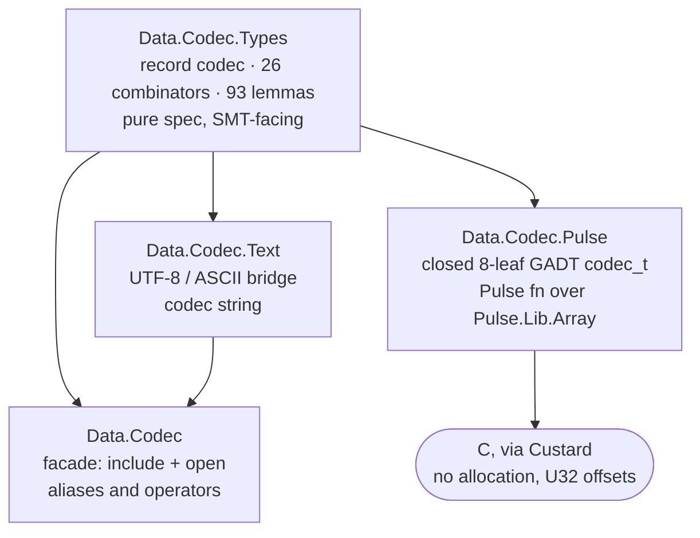

# codec (F\*)

A verified, bidirectional codec library: **one description, two directions.**

`codec` implements Tillmann Rendel and Klaus Ostermann's _"Invertible Syntax
Descriptions: Unifying Parsing and Pretty Printing"_ (Haskell'10, September 30
2010, Baltimore, Maryland, USA; ACM) in **F\***, re-based from text onto **bytes**.

The paper gives one idea: a description drives both decoding and encoding, and
every block in it is a *partial isomorphism* whose two directions are related by
an inverse law. Implementing that idea in F\* immediately meets a second set of
obligations the paper never faces, because F\* is not only a proof assistant: the
same description must also be an **OCaml model** and a **C program extracted by
Custard through Pulse, over fixed buffers, with no allocation on the hot path**.

This document is the architecture statement: what the library is, every place it
departs from the paper, what it proves that the paper does not, and — in its own
section, not as a footnote — **what it gives up**. An honest statement of a codec
has to carry the losses alongside the results, or a reader cannot tell which
guarantees they are actually getting.

Anchors `[D1]`–`[D11]` (departures), `[S1]`–`[S7]` (strengthenings), `[W1]`–`[W7]`
(weaknesses) and `[O1]` (open problem) are stable cross-reference targets.

---

## The idea, in one breath

The value-level transformations in a syntax description are **partial
isomorphisms** — a box with two doors, `apply` and `unapply`, each the other's
inverse. Know how to go into the box and you know how to come back out, because
the two doors are the same fact stated twice. One description therefore drives
**decode** (bytes in, value out) and **encode** (value in, bytes out), and the
two are provably inverse.

The paper states that inverse law in prose. §5 names the cost directly: a
partial isomorphism written with the constructor "is not safe because **it is not
checked that the two directions are really inverse to each other**". §7.5 leaves
the follow-up open:

> "It would be interesting to see **how the invariants of `Iso` values could be
> encoded in a dependently typed language**"

This library answers that question for F\*: the law is a **field**, so a codec
without its proof cannot be constructed. In F\* the answer cannot be a single
unconditional biconditional — the reasons are `[D2]`, `[D5]` and `[D9]`, and the
resulting loss of strength is stated as `[W1]` rather than folded into the claim.

---

## The shape of the library



| Module | Lines | Role | Extracts to |
|---|---|---|---|
| `Data.Codec.Types` | 4,216 | the record `codec a`, all 26 combinators, 93 lemmas | OCaml only (pure spec) |
| `Data.Codec.Text` | 188 | `text : string -> codec string`, UTF-8/ASCII bridge | OCaml only |
| `Data.Codec` | 140 | facade: re-exports, long-name aliases, operators | OCaml only |
| `Data.Codec.Pulse` | 1,334 | 8-leaf `codec_t`, 27 `fn`s incl. 8 roundtrip lemmas | **C, OCaml, F#** |

The C-facing tier is a separate module with a deliberately *closed* leaf set
(`[D11]`); nothing in core bakes in a text or machine format, and text is a
downstream module built on bytes.

Zero `admit`, zero `assume val` in `src/`.

---

## Departures from the paper (observable-semantics changes)

### [D1] `String`/`Char` → bytes

The paper's concrete syntax is textual: the decoder is `Parser (String → [(α,
String)])` (§4.1) and the primitive token is over `Char`; the value graph is given
as `Rel :: [(α, String)]` (§4.3). A binary format is not made of characters —
many of its bytes are not printable at all. So the base unit is a **byte**, the
base string is a byte sequence, and `token : codec byte` is the paper's `token`
on the new carrier. Text and Unicode are rebuilt downstream, on top of bytes,
never underneath.

### [D2] A single-answer decoder

The paper's decoder returns a **list** of `(value, remaining)` pairs — every way
to read the input — and `|` is their union (§4.3).

This library's decoder returns **one** answer or an error:

```fstar
type decode_result (a: Type0) = either decode_error (a & nat)   (* (value, consumed) *)
```

**Why.** The decoder has to be the one Custard extracts. A list per parse is an
allocation on the hot path, it has no lowering to a buffer and cursor, and
backtracking costs are exponential — the paper's own admitted cost (§4.4: "limits
its applicability to large inputs"). The extraction contract is a populated
buffer and a `u32` cursor; a returned list is the one shape that cannot become
that.

**What it costs.** Backtracking is what makes a decoding law unconditional: with
every answer retained, the correct one is always present, so no stopping
condition is needed. With a single answer the decoder may pick a greedy wrong
one, and the loss must be paid explicitly. That payment is `[D9]`, and the
guarantee given up is `[W4]`.

### [D3] `alt` selects a branch from the input

Under `[D2]` the two branches cannot both be tried, so the choice must be decided
from the bytes. `alt` therefore takes a discriminator over the first byte:

```fstar
let alt (#a #b: Type) (c1: codec a) (c2: codec b) (p1: byte -> bool) : codec (either a b)
```

The paper treats the two directions asymmetrically — its parser `|` is
backtracking union (§4.1) while its printer `|` is left-biased `mplus` (§4.2).
This library keeps one direction of each: the reader decides from the input (the
printer's left-bias), and the resulting obligation is stated in the type, not left
implicit (`[S3]`).

### [D4] Lossless capture — there is no `ignore`

The paper (§6.3) defines `ignore :: α → Iso α ()`, and says so itself:
"`ignore` is again not a strict partial isomorphism, because **all values of `α`
are mapped to ()**". `skipSpace` and `optSpace` are its two direct
instantiations, and they lose the run: three blanks in, a fixed run out.

No `ignore` exists here. The `roundtrip` field requires `dec (enc v ++ r)` to
return `v`, and a constant encoder cannot recover which run it saw, so the
combinator cannot be written. A run of allowed bytes is instead *captured* as a
value and re-emitted verbatim — same length, same bytes.

Where the paper relaxes the law to keep a destructive constructor, this library
keeps the law and drops the constructor.

### [D5] `codec` is a **record of functions**, not an inductive syntax tree

The paper's descriptions are values of a typeclass (§3.4). Here a codec is a
record:

```fstar
noeq
type codec (a: Type) = {
  enc        : a -> Tot byte_seq;                  (* total *)
  dec        : byte_seq -> Tot (decode_result a);  (* one answer or an error *)
  wfcv       : a -> Tot bool;                      (* runtime well-formedness *)
  wfcv_prop  : a -> Tot prop;                      (* its proof mirror *)
  rest_cond  : a -> byte_seq -> Tot prop;          (* continuation condition *)
  roundtrip  : (v: a) -> (r: byte_seq) -> Lemma
    (requires wfcv v /\ wfcv_prop v /\ rest_cond v r)
    (ensures dec (enc v `Seq.append` r) == Inr (v, Seq.length (enc v)));
  dec_err_bound      : ... ;
  dec_consumed_bound : ... ;
}
```

**Why a record rather than an AST.** Each field is a *projection*, so
`token.enc v` normalises under SMT. That is what discharges 27 roundtrips with no
induction at all, and it is also what makes a codec usable as a value in
extracted code, where an AST with function-valued leaves does not lower
(`[D11]`).

**What it costs.** A `noeq` record's fields are opaque across module boundaries,
so every combinator needs accessor lemmas (`lemma_map_wfcv`, `lemma_alt_enc`, …),
and the laws are per-combinator solver lemmas rather than one induction over a
structure. That is `[W2]`.

### [D6] `enc` is total; well-formedness is a `bool` **and** a `prop`

The paper's `apply` is a `Maybe`-valued partial function. Here `enc` is total:

```fstar
enc : a -> Tot byte_seq
```

correct only inside `wfcv`. Applied out of domain it emits *something* —
`uint8.enc 1000` yields `0xE8` through `v % 256`.

**Why the split survives.** The guard has to be reachable from a runtime check.
The C caller reaches `encode_uint` with a `U32.t` and discharges
`pure (U32.v v < 65536)` in the Pulse precondition, so well-formedness is a fact
about **values at run time**, not only about proofs; a `prop` is erased before it
reaches the checker. Once `wfcv` is a field, a second field exists to let the
*proof* consume the same fact (`wfcv_prop`, `fstar-proofs` §18).

**Honest status.** AUDIT §3 is **not** resolved: `wfcv` and `wfcv_prop` are two
encodings of one fact. That redundancy is `[W1]`'s clearest instance, and
`codec_v2` (`[S7]`) removes it.

### [D7] `dec` reports **consumed bytes**, not a remainder — and `remainder` is the fix

The decoder returns `(value, nat)`, the `nat` being claimed-consumed bytes.
`product` re-slices with `Seq.slice s n1 (|s|)` trusting it, and
`dec_consumed_bound` is a separate lemma that repairs the trust. The bound is not
a typing fact anywhere.

The migration replaces the `nat` with a refined remainder:

```fstar
let remainder (s: byte_seq) = r:byte_seq{ Seq.length r <= Seq.length s }
```

The bound is carried **in the type**, so consumers receive it without a
precondition of their own, and `dec_consumed_bound` becomes structural (`[S2]`)
instead of a field. This is load-bearing: without the refinement `product`
inherits an undischargeable `|r₁| ≤ |s|`.

### [D8] Two record types coexist during migration: `codec` and `codec_v2`

`codec` above is the shipping type, used by all 26 combinators, and is the one
`Data.Codec.Pulse`'s post-conditions name. `codec_v2` is the strict bidirectional
type being migrated to, defined at the **end** of `Data.Codec.Types` and used by
**no combinator yet**.

The two cannot share a name while 27 `roundtrip` fields migrate one at a time, so
`_v2` is a **temporary** label: the end state renames it back to `codec`. There is
deliberately no `codec_v3`. The duplication is a migration artifact and a cost,
not a design goal.

Its placement is constrained: `codec_v2` must be declared *after*
`sep_by1_opt_trailing_roundtrip`. Declaring it earlier makes that lemma's
obligation unprovable (`Error 19`), and raising `--z3rlimit` to 1600 does not
help. Bisection showed the trigger is `law_bwd`'s `exists` binder, not
line-shifting.

### [D9] The laws are **conditional**: `wfcv`, `wfcv_prop`, `rest_cond`

The paper's inverse law is unconditional, because §3.1 leaves it in prose and
§6.3 relaxes it to "modulo equivalence classes" whenever a destructive
constructor appears. Here the law is a field **and** carries three hypotheses:

```fstar
roundtrip : (v: a) -> (r: byte_seq) -> Lemma
  (requires wfcv v /\ wfcv_prop v /\ rest_cond v r)
  (ensures dec (enc v `Seq.append` r) == Inr (v, Seq.length (enc v)));
```

Each hypothesis is the F\* encoding of a fact the paper's design supplies
otherwise:

| the paper supplies it by | this library must state it | because |
|---|---|---|
| returning **every** answer (§4.3), so the correct one is always present | `rest_cond` | a single-answer decoder can select the greedy answer that over-consumes `r` |
| `apply : α → Maybe β`, partial **by type** | `wfcv` | the C caller needs a runtime-checkable `bool`, not an erased `prop` |
| the type of `Iso` itself | `wfcv_prop` | the proof needs the proposition that the `bool` decides |

This is the central departure. It is not a taste: it is what `[D2]` and `[D5]`
cost, and it is the reason `[S1]` cannot claim the paper's unconditional law.
Removing any of the three requires first removing the departure that created it —
`[O1]` records the only route that does so.

Note also what `[D9]` is *not*. The paper's own escape hatch is equivalence
classes ("we will sometimes interpret this condition modulo equivalence
classes", §3.1). This library does **not** take that route: `[D4]` shows the
constructor that would need it is absent, and the three hypotheses are *exact*
conditions — a specific run must not extend, a specific value must be in range —
not classes. A conditional law whose conditions are precise is a different
object from a law relaxed to hold "up to" a quotient.

### [D10] The carrier is `Seq byte` plus a refined remainder

All laws are stated over `FStar.Seq.seq byte`, with the suffix bound carried in
`remainder` (`[D7]`). This is deliberate and has three independent reasons:

1. **Reduction for proof.** `Seq` has 93 lemmas behind it; a length-indexed
   function type would be opaque to the solver and every law would need
   hand-written index facts where `Seq` has a library.
2. **The extraction contract.** Custard consumes `Pulse.Lib.Array.array U8.t`
   through `pts_to` views and `u32` offsets. A `Seq` is erased; it can never be
   the runtime carrier.
3. **Vocabulary.** Every Pulse post-condition and every downstream consumer is
   already stated over `Seq byte`.

The consequence must be stated plainly: the specification carrier and the runtime
carrier are **two different things**, and the obligation is to prove them agree
(`lemma_pulse_roundtrip_*`, `[D11]`). The alternative — one carrier that is both —
is not available in F\*, because a carrier reducible for the solver is not one
Custard can read.

### [D11] The C-facing tier is a **closed 8-leaf GADT**, not the record

The paper has one representation. This library has two, and must:

```fstar
type codec_t =
  | CT_Token | CT_ByteVal of U8.t | CT_Uint8 | CT_Word16BE
  | CT_Word32BE | CT_Word16LE | CT_Word32LE | CT_Varint
```

The source states its own exclusion rule: *"`CT_Satisfy` excluded: function-typed
constructor breaks extraction. `CT_Bytes`, `CT_Text` excluded: use the pure-spec
bridge."*

**Why the record cannot be extracted.** Custard monomorphizes and emits C with no
closures and no `Prims.int`; a record holding `a -> option byte_seq` is a
function pointer at best and untranslatable at worst. `decode_bytes` therefore
takes a **tag**, not a codec, and every `fn` carries a byte-level separation-logic
post-condition proved to agree with the pure spec.

**What this costs.** The dispatcher covers 8 leaves (2 per word width, plus
`token`, `uint8`, `varint`). Everything else — `product`, `alt`, `sep_by1*`,
`take_until`, `opt_prefixed`, `satisfy_many*` — has a pure spec and **no C
execution path**. That gap is `[W6]`.

---

## Strengthenings (what this library proves that the paper does not)

An entry belongs here only if it adds a fact the paper **does not state or does
not check**. That is the sole criterion; the paper is the reference point
throughout, and no entry in this section depends on another implementation.

### [S1] The inverse law is **enforced by the type** — the answer to §7.5

The paper leaves the `Iso` invariant in prose (§3.1) and names the cost in §5:
"it is not safe because **it is not checked that the two directions are really
inverse to each other**". §7.5 then asks how the invariant could be encoded in a
dependently typed language.

Here the law is a **field** (`roundtrip`), so a codec without its proof cannot be
constructed. This answers §7.5 for F\*.

**Scope.** This entry claims *enforcement*, not *unconditionality*. The law is
concrete, checkable at every construction site, and impossible to omit — an
advance over prose. What it does not claim is that the law holds with no
hypotheses: it does not, and the three hypotheses are `[D9]`, with the resulting
loss of strength recorded as `[W1]`. A conditional obligation that the compiler
demands is still strictly more than an unconditional claim that nothing checks —
but it is not the same thing, and this document does not pretend otherwise.

### [S2] The consumed-byte bound becomes **structural**

In the paper's `(α, String)` formulation the remaining input is part of the
result, so "the parser consumed at most the input" needs no statement. In this
library's legacy record, where `dec` returns `(value, nat)`, that bound is a
separate field — and every one of its 27 instances is `(fun s -> ())`, i.e. dead
weight that proves nothing on its own.

Under `remainder` (`[D7]`) the bound follows from the type: from
`dec s = Some (v, r)` we get `|r| ≤ |s|` by construction. It survives as a
**lemma**, not a field. The strengthening is that a fact which was previously
asserted per codec is now derived once from the carrier.

### [S3] The branch-selection obligation is stated in the type

The paper's `|` needs no condition because it tries both branches. This library
must select one (`[D3]`), and rather than leave that as an undocumented
precondition it states an obligation — `alt_wfcv` — **in the constructor's
type**, once, so every call site is checked against it.

**Scope.** The strengthening is over *silence*: the paper has no such obligation
to be stronger than. Its existence is a cost of `[D3]` and is recorded as
`[W4]`; what is strengthened is that the cost is visible, decidable, and
mechanically enforced rather than implicit in an implementation.

### [S4] `codec` quantifies over `eqtype`

The paper's `Iso` is over any `Type`. Here it is over types with decidable
equality. This is a restriction, and it is a *strengthening of the specification*:
`dec (enc v ++ r) = Inr (v, …)` becomes a decidable proposition the solver can
work with, and value identity is available to the proofs and the extracted code
alike.

It is also free in practice: every value type in the library and its consumers is
a record/list/option of `string`/`int`/`byte`, all of which carry `eqtype`.

### [S5] A facade with two naming layers

`CODE_GUIDELINES.md` requires every combinator to have a long descriptive name
**and**, where the operator is recognised, an operator alias: `then_drop`/`*>`,
`drop_then`/`<*`, `choice`/`<|>`, `bind`/`>>=`. `Data.Codec` is a facade
(`include` **and** `open`, per `fstar-2026.09.20` §10.2) so both spellings reach
consumers. The paper has one spelling per combinator; this is a host-language
convention, recorded so it is not mistaken for a semantic choice.

### [S6] 93 lemmas, mechanically anchored against deletion

The pure tier carries 93 `lemma_*` and they are anchored by name in
`Data.Codec.Test.Integration`, so deleting or renaming one breaks verification.
Value-level combinators are anchored too (34 `_co*` bindings), which is how a
silent `alt` deletion would be caught (`fstar-2026.09.20` §9). The paper, being
prose plus listings, has no equivalent guarantee.

**Scope.** The coverage is not complete — `opt_prefixed` is unanchored, recorded
as `[W7]`. This entry claims the mechanism, not total coverage.

### [S7] Direction-split predicates: `rest_cond_v` for `law_fwd` only

The paper has no stopping condition at all. Where one is needed, this library
supplies it **exactly**, not heuristically, and splits it by direction in the
migration target (`codec_v2`): `law_fwd` consumes a value-indexed `rest_cond_v`
because it has the value; `law_bwd` consumes nothing because the value is what it
is recovering.

This is what makes the greedy combinators provable in both directions. An earlier
design used one predicate shared by both laws, and it is **circular** — `law_bwd`
would need the encoding of a value it has not yet recovered. Splitting by
direction dissolves the circularity, and it is the reason `sep_by1`'s forward law
threads at all: with the value-indexed form, the tail's obligation is a
*conjunct* of the head's, so the induction is conjunction elimination rather than
an unprovable prefix-closure step.

**Scope.** The strengthening is over the *paper*, which has no stopping condition.
This condition does not remove `[W1]` — it is one of `[W1]`'s hypotheses, and its
exactness (a precise maximality condition, not a class) is what keeps `[D9]` from
becoming a §6.3-style quotient.

---

## Weaknesses (what this library gives up)

Every entry here is a **loss of guarantee** against the paper. Each states what is
lost and why it was accepted. The reasons are real — the C path, the extraction
model, a single-answer decoder — but a real reason makes a trade honest; it does
not make the result a strengthening, and this document does not file it as one.

### [W1] The inverse law is conditional, and redundant in one place

The paper's ideal is one unconditional law. Here it carries three hypotheses
(`[D9]`), so a caller cannot conclude that encoding is recoverable without first
establishing `wfcv v`, `wfcv_prop v` and `rest_cond v r`.

**What is lost.** "Invertible" is no longer a property of the description: it is
a property of the description *on a domain the caller must supply*. Code written
against a codec carries obligations that the paper's prose would not impose.

**Why accepted.** Each hypothesis mirrors something the paper's design supplies
for free (`[D2]`, `[D6]`). Removing one requires removing the departure that
created it (`[O1]`).

**Honest note.** Of the three, only `wfcv_prop` is *purely* a cost: it exists
solely to mirror `wfcv` as a proposition, and proves nothing `wfcv` does not
already drive. `wfcv` corresponds to a real runtime check and `rest_cond` to a
real stopping condition; `wfcv_prop` is redundancy. It is the clearest single
weakening in the library, and `codec_v2` (`[S7]`) removes it.

### [W2] Invertibility is solver-borne, not structural

The paper's argument for its combinators is prose per §. Here each combinator
carries its own Z3 `Lemma` field on an opaque `noeq` record, so "all codecs are
invertible" is a **27-lemma family**, not one argument, and each lemma is
sensitive to `--z3rlimit` and `--fuel`.

**What is lost.** Auditability. A reader cannot verify the claim by reading a
proof, and a resource-limit change can move a failure. The paper at least states
one invariant for the whole category.

**Why accepted.** `[D5]`: an AST with function-valued leaves does not extract,
and projection fields are what make the roundtrips discharge without induction at
all. The two goals trade against each other directly.

**Status.** AUDIT §4. **Not resolved** by this library, and not by the migration
in flight.

### [W3] `enc` is total, so an out-of-domain value produces a wrong answer instead of an error

The paper's `apply : α → Maybe β` makes an out-of-domain input unrepresentable at
the type. Here `enc : a -> Tot byte_seq` always returns bytes:
`uint8.enc 1000` yields `0xE8` (`v % 256`) rather than any failure.

**What is lost.** The type no longer prevents the mistake. A caller that ignores
`wfcv` gets silent corruption rather than a type error, and nothing in the shape
of `enc` signals that a precondition exists.

**Why accepted.** `[D6]`: the C path needs an allocation-free total encoder and a
single runtime guard. `codec_v2`'s `enc : a -> option byte_seq` is the fix, and
is what the migration lands.

### [W4] No backtracking: `alt` needs a discriminator supplied by the caller

The paper's `|` is backtracking union (§4.3) and its `many` is built from it. Here
`alt` takes `p1 : byte -> bool` (`[D3]`).

**What is lost.** Two things. A description that cannot be told apart from its
first byte cannot be expressed at all — a real restriction on the accepted
grammar. And the paper's `many` has no analogue of the same shape: `count`,
`satisfy_many*`, `sep_by1*` and `take_until` cover the use cases, but each needs
an explicit bound or terminator from the caller rather than deriving one.

The paper's §4.4 notes its own cost of backtracking (worst-case exponential, a
space leak); this library avoids that, at the price above.

**Why accepted.** `[D2]`: single-answer decoding is what lifts to a `u32` cursor
over a populated buffer with no allocation.

### [W5] `map_`'s backward law needs an extra obligation

Under the strict type, `map_` cannot derive that its conversion pair is inverse
on the decoded value: a law-abiding codec plus a concrete `(f, g)` refute
derivability outright. The weakest sufficient hypothesis is
`map_retract_on_image`, quantified over the codec's image rather than universally.

**What is lost.** A `map_` user carries a hypothesis the paper has no analogue
for, supplied at the call site because a value-dependent law cannot be a record
field (`[S7]`).

**Why accepted.** Forced by `[D5]`'s record shape. It is not an extra practical
burden in one respect worth recording: the folded guard is only satisfiable
*together with* the retract property, so any usable `map_` already implies it.

### [W6] The C execution path covers 8 leaves, not the library

`[D11]`'s `codec_t` dispatches 8 leaves. `product`, `alt`, `sep_by1*`,
`take_until`, `opt_prefixed` and `satisfy_many*` have a pure specification and
**no C path**.

**What is lost.** "The library extracts to C" is true of the leaves only. A
consumer that needs a composite codec in C cannot have one.

**Why accepted.** Function-valued constructors break extraction, by design, so a
closed tag enumeration is the only shape that lowers.

### [W7] One combinator lacks a coverage anchor

`opt_prefixed` has no `let _x = opt_prefixed` anchor in
`Data.Codec.Test.Integration`, so renaming or deleting it would leave the build
green. The other tested values (`alt`, `take_until`, `sep_by1`, `one_of`,
`satisfy_many0`, …) are anchored among the 34 `_co*` bindings.

**What is lost.** A single hole in the mechanism that otherwise guarantees no
combinator silently disappears. It is recorded as a weakness because the guarantee
is what the mechanism is measured against, and here it does not hold.

---

## Open: the one route to an unconditional law

### [O1] A dual carrier — list-valued specification, single-answer runtime

The only known way to obtain an **unconditional** law (`[W1]` removed) while
keeping the C path is to separate the specification carrier from the runtime one:

- `dec_spec : byte_seq -> list (a & remainder s)` — **every** answer, which makes
  the inverse law unconditional, since the correct answer is always present; and
- `dec_run : byte_seq -> option (a & remainder s)` — the single answer the
  runtime and Pulse use;
- with a proved relation between them on the accepted set.

This is a coherent design, and it is the honest completion of the paper's §4.3
semantics under F\*'s extraction constraints.

**What it costs.** It doubles the combinator surface (two decoders per node), adds
a bridge obligation at every node, and requires that bridge to be stated in a form
the solver actually discharges. The risk that killed earlier attempts was
precisely that the "which answer did we pick" fact is *unprovable*, not merely
unproved.

**Not adopted in the current change.** The current migration lands `codec_v2`
(`[S7]`, conditional but double-sided) and treats `[O1]` as its own gated piece
of work. It is recorded here so the gap against the paper is a **decision**, not
an omission.

---

## Representations, and why the carrier is `Seq byte`

| | **`Seq byte` + `remainder s`** |
|---|---|
| Role | the specification carrier for all laws |
| Reducible for proofs | via 93 `Seq` lemmas, not by unfolding |
| At runtime | erased; C uses `Pulse.Lib.Array.array U8.t` + `u32` offsets |
| Suffix bound | `remainder s` refinement (`[D7]`) |
| C representation | a separate closed tag enumeration (`[D11]`) |

The trade is explicit: a carrier reducible for the solver and a carrier readable
by the extractor are different objects in F\*. The library keeps them separate
and proves they agree, rather than pretending one object can be both.

---

## The migration in flight

The change `codec-strict-isomorphism` replaces the one-way `roundtrip` (`[D5]`,
`[D9]`) with a strict bidirectional type in which **both** directions are fields.
Status, honestly:

| | `law_fwd` | `law_bwd` | Where |
|---|---|---|---|
| `token` | ✅ | ✅ | spike |
| `product` | ✅ | ✅ | spike |
| `alt` | ✅ | ✅ | spike |
| `sep_by1` | ✅ | ✅ | spike |
| greedy `satisfy_many0` | ✅ | ✅ | spike |
| `count` (positional) | ✅ | ✅ | spike |
| `map_` | ✅ w/ the folded guard | ✅ w/ `map_retract_on_image` | spike |
| `sum` | ✅ | ✅ | spike, derived from `token` |

Every structural combinator is a machine-checked spike; **nothing is migrated in
`src/` yet**.

Two facts from that work worth carrying forward, because they constrain the
design rather than merely describing it:

- **A value-dependent `wfcv_prop` cannot be a record field.** `[D5]`'s record
  quantifies over a fixed value with the encoding bound existentially, so a guard
  that mentions the value being recovered cannot inhabit a field. `map_`'s guard
  must therefore be folded into a single `wfcv`; the fold is forced by the type,
  not chosen for convenience.
- **A proof that needs `--z3rlimit 250+` and still will not close usually has a
  wrong definition, not a missing lemma.** `sum` failed in six hand-written
  `if`-chain formulations and proved at `--z3rlimit 40` once derived from
  `token`.

---

## What this library claims, and what it does not

**Kept from the paper.** The idea — one description, two directions, related by
invertibility; partial encoding; the `×`/`|`/`pure`/`token`/`satisfy` structure;
relations as the specification of decoding.

**Completed (relative to the paper).** The inverse law is enforced by the type
(`[S1]`); the consumed-byte bound is structural (`[S2]`, `[D7]`); the
branch-selection obligation is stated rather than implicit (`[S3]`); a stopping
condition exists and is exact rather than a quotient (`[S7]`); deletion of any
lemma or combinator is mechanically caught (`[S6]`).

**Given up.** An unconditional law (`[W1]`), structural rather than solver-borne
invertibility (`[W2]`), `enc` partiality enforced by the type (`[W3]`),
backtracking and a caller-free `many` (`[W4]`), a `map_` needing no retract
obligation (`[W5]`), a C path for every combinator rather than 8 leaves (`[W6]`),
and complete anchor coverage (`[W7]`). These are losses, not trades dressed as
gains.

**Departed from the paper, and why.** A single-answer decoder (`[D2]`), tag-first
`alt` (`[D3]`), a record rather than a typeclass-based description (`[D5]`), a
runtime `bool` guard (`[D6]`), conditional laws (`[D9]`), a `Seq` carrier
(`[D10]`), and a closed tagged enumeration for C (`[D11]`). Every one traces to
one fact: **three interpreters, one description, and one of the three is C.**

**Not claimed.** AUDIT §4 — that invertibility is *structural*. That needs either
an inductive `Codec` with a recursive decoder, which `[D5]` argues against on
extraction grounds, or `[O1]`'s dual carrier, which is not adopted. AUDIT §3 is
only partially met: `codec_v2` (`[S7]`) collapses `wfcv`/`wfcv_prop` to one guard.
Both residuals are filed as weaknesses (`[W1]`, `[W2]`), not as strengthenings
with a caveat.

---

## Building

```bash
nix develop -c make check        # verify (7 modules, 0 admit)
nix build .#native               # Custard → C
```
