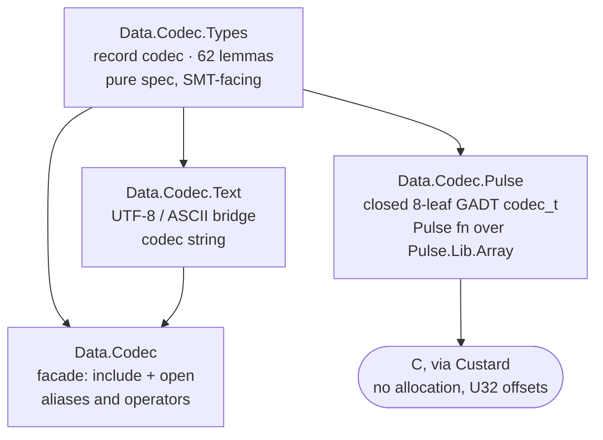

# codec

A verified, bidirectional codec library: **one description, two directions.**

`codec` takes Tillmann Rendel and Klaus Ostermann's _"Invertible Syntax
Descriptions: Unifying Parsing and Pretty Printing"_ (Haskell'10, September 30
2010, Baltimore, Maryland, USA; ACM) and carries it to **F\***, re-based from
text onto **bytes**.

The paper gives the idea: a description drives both decoding and encoding, and
every block in it is a *partial isomorphism* whose two directions are related by
an inverse law. Implementing that in F\* immediately meets obligations the paper
never faces, because F\* is not only a proof assistant here: the same
description must also be an **OCaml model** and a **C program extracted by
Custard through Pulse, over fixed buffers, with no allocation on the hot path**.

This document is the architecture statement: what the library is, every place it
departs from the paper, what it proves that the paper does not, and — in its own
section, not as a footnote — **what it gives up**. An honest statement of a codec
has to carry the losses alongside the results, or a reader cannot tell which
guarantees they are actually getting.

Anchors `[D1]`–`[D13]` (departures), `[S1]`–`[S9]` (strengthenings),
`[W1]`–`[W9]` (weaknesses) and `[O1]` (open problem) are stable
cross-reference targets.

---

## The idea, in one breath

The value-level transformations in a syntax description are **partial
isomorphisms** — a box with two doors, `apply` and `unapply`, each the other's
inverse. Know how to go into the box and you know how to come back out, because
the two doors are the same fact stated twice. One description therefore drives
**decode** (bytes in, value out) and **encode** (value in, bytes out), and the
two are provably inverse.

The paper states that inverse law in prose, and names the cost of not checking
it. §5: a partial isomorphism written with the constructor "is not safe because
**it is not checked that the two directions are really inverse to each other**".
§7.5 leaves the follow-up open:

> "It would be interesting to see **how the invariants of `Iso` values could be
> encoded in a dependently typed language**"

This library answers that question for F\*: the inverse law is a **field**, so a
codec without its proof cannot be constructed. In F\* the answer cannot be a
single unconditional biconditional — the reasons are `[D2]`, `[D5]` and `[D9]`,
and the resulting loss of strength is stated as `[W1]` rather than folded into
the claim.

The proofs are erased before extraction, so the check costs nothing at runtime.

---

## The shape of the library



| Module | Role | Extracts to |
|---|---|---|
| `Data.Codec.Types` | the record `codec a`, all combinators on bytes, 62 lemmas | OCaml only (pure spec) |
| `Data.Codec.Text` | `text : string -> codec string`, UTF-8/ASCII bridge | OCaml only |
| `Data.Codec` | facade: re-exports, long-name aliases, operators | OCaml only |
| `Data.Codec.Pulse` | 8-leaf `codec_t`, the `fn`s and their roundtrip lemmas | **C, OCaml, F#** |

**67 lemmas, 0 admits.** No `admit`, no `assume val` anywhere in `src/`;
`make check` verifies **7 modules**.

The C-facing tier is a separate module with a deliberately *closed* leaf set
(`[D11]`); nothing in core bakes in a text or machine format, and text is a
downstream module built on bytes.

**Module scope rule.** `Data.Codec.Types` is the *core*: it must not acquire a
dependency on `Data.Codec.Text`, and it holds no text handling. Anything that
names a character, a string, or an ASCII predicate belongs in `Data.Codec.Text`.
The machine-specific integer/varint leaves still live in core because the Pulse C
dispatcher (`codec_t`) names them directly through
`module DC = Data.Codec.Types`; separating them requires splitting that
dispatcher (its own change: `codec-binary-tier-split`).

---

## From the paper to a binary codec

This is the canonical record of every place `codec` departs from the paper (a
*_departure_* — an observable-semantics change) or completes it (a
*_strengthening_* — no observable-semantics change), plus what it gives up (a
*_weakness_*). Each entry cites the paper's § and the F\* symbol that implements
it, so a porter can read this one list and know exactly what to reproduce.
Anchors `[D1]`–`[D13]`, `[S1]`–`[S9]`, `[W1]`–`[W9]` and `[O1]` are stable
cross-reference targets, shared with the code and the engineering ledger in
`openspec/`.

Section numbers below refer to the paper's own sectioning as reproduced in
`../lean-codec/PAPER.md` (the paper uses a mix of `§n` and `§n.m`; where a fact
lives in a subsection we cite the subsection).

**One fact explains most of the departures: this library has three interpreters
for one description — a specification the SMT solver reasons about, an
executable model produced by OCaml extraction, and a C program extracted by
Custard through Pulse over fixed buffers.** The third is the binding constraint:
`[D2]`, `[D5]`, `[D6]`, `[D9]`, `[D10]` and `[D11]` all trace to a fact about C —
no closures, no sum types, no allocation, `u32` offsets over a caller-owned
buffer. Dropping any *other* interpreter would not relax one of them.

### Departures (observable-semantics changes)

**[D1] `String`/`Char` → _bytes_.** §4.1's syntax is textual: the decoder is
`Parser (String → [(α, String)])` and the token primitive is over `Char`; §4.3's
value graph is `Rel [(α, String)]`. A binary format is not made of characters —
many of its bytes are not printable at all. So the base unit is a **byte**, the
base string is a byte sequence, and `token : codec byte` is the paper's `token`
on the new carrier. Text and Unicode are rebuilt downstream, **on top of**
bytes, never underneath.

**[D2] a _single-answer_ decoder.** §4.3's decoder returns *every* parse, and
`\|` is their union. This one returns `either decode_error (a & nat)` — one
answer or an error — because the decoder is the one Custard extracts: a list per
parse is an allocation on the hot path, it has no lowering to a
buffer-and-cursor, and §4.4 already admits backtracking's exponential cost
("limits its applicability to large inputs"). **Cost:** see `[W4]`.

**[D3] `alt` _selects from the input_.** With one answer both branches cannot be
tried, so the choice must be decided from the bytes: `alt` takes `p1 : byte ->
bool`. The paper is already asymmetric — parser `\|` is backtracking union
(§4.1), printer `\|` is left-biased `mplus` (§4.2) — and this keeps one
direction of each. The obligation is stated in the type (`[S3]`).

**[D4] _no `ignore`_.** §6.3's `ignore :: α → Iso α ()` — "not a strict partial
isomorphism, because **all values of `α` are mapped to ()**". `skipSpace` and
`optSpace` are its two direct instantiations, and they lose the run: three
blanks in, a fixed run out. No `ignore` exists here. The `roundtrip` field
requires `dec (enc v ++ r)` to return `v`, and a constant encoder cannot recover
which run it saw, so the combinator cannot be written. A run of allowed bytes is
instead *captured* as a value and re-emitted verbatim — same length, same bytes.
**Where the paper relaxes the law to keep a destructive constructor, this
library keeps the law and drops the constructor.**

**[D5] `codec` is a _record of functions_, not §3.4's typeclass.** Each field is
a *projection*, so `token.enc v` normalises under SMT — which is what discharges
the roundtrips with no induction — and a record lowers where an AST with
function-valued leaves does not (`[D11]`). **Cost:** a `noeq` record's fields
are opaque across module boundaries, so every combinator needs accessor lemmas
and the laws are per-combinator solver lemmas rather than one induction
(`[W2]`).

**[D6] `enc` is _total_; well-formedness is a `bool` *and* a `prop`.** The guard
must be reachable from a runtime check: the C caller discharges `pure (U32.v v <
65536)` in a Pulse precondition, and a `prop` is erased before it reaches the
checker. Once `wfcv` is a field, a second field (`wfcv_prop`) exists so the
*proof* can consume the same fact. **Cost:** `[W3]`, and the redundancy in
`[W1]`.

**[D7] `dec` reports _consumed bytes_, and `remainder` is the fix.** `(value,
nat)` trusts a claimed count that `dec_consumed_bound` repairs by lemma.
`remainder s = r:byte_seq{ \|r\| ≤ \|s\| }` carries the bound in the type, so
consumers get it free and the bound becomes structural (`[S2]`). Load-bearing:
without it `product` inherits an undischargeable `\|r₁\| ≤ \|s\|`.

**[D8] `codec` and `codec_v2` _coexist_ during migration.** The two cannot share
a name while 27 `roundtrip` fields migrate one at a time. `_v2` is a
**temporary** label; the end state renames it back. Placement is constrained:
`codec_v2` must be declared *after* `sep_by1_opt_trailing_roundtrip`, or that
lemma's obligation becomes unprovable (`Error 19`; rlimit 1600 does not help).

**[D9] the laws are _conditional_.** The central departure. See the dedicated
section below.

**[D10] the carrier is _`Seq byte`_ plus a refined remainder.** Three
independent reasons: `Seq` has 93 lemmas behind it, so laws reduce; Custard
consumes `Pulse.Lib.Array.array U8.t` through `pts_to` views and `u32` offsets,
so a `Seq` can never be the runtime carrier; and every Pulse post-condition and
downstream consumer is already stated over `Seq byte`. **Consequence:** the
specification carrier and the runtime carrier are two objects, and the
obligation is to prove they agree.

**[D11] a _closed 8-leaf GADT_ for C.** Custard emits C with no closures and no
`Prims.int`; a record holding `a -> option byte_seq` does not translate.
`decode_bytes` takes a tag, not a codec, and every `fn` carries a byte-level
separation-logic post-condition proved to agree with the pure spec. The source
states the exclusion rule: *"`CT_Satisfy` excluded: function-typed constructor
breaks extraction. `CT_Bytes`, `CT_Text` excluded: use the pure-spec bridge."*
**Cost:** `[W6]`.

**[D12] _leading zeros are padding, not digits_ — a numeric reader rejects
them.** §6.4's `integer` is `Iso read' show' $ many digit`, where `read'`
accepts whatever `reads` accepts, whole-string. `reads "01"` succeeds, so the
paper's `integer` **decodes `"01"` to `1` while `show' 1 = "1"`** — its own
inverse law fails on that input exactly as `ignore`'s does (§6.3), and the paper
does not say so. This library rejects the leading zero: `enc 1 = "1"` always, so
`"01"` is outside the codec's image, and a reader that accepted it would make
`law_bwd` false. **Why this is a departure and not a bug-fix**: it changes what
the paper's `integer` accepts. "`[D12]` in full", immediately below, gives the
classification and what it costs.

**[D13] _numeric readers accept exactly the encoder's image_.** `varint`
(LEB128) and `digits_to_int` reject input their encoder never produces —
overlong LEB128 (`[0x80;0x00]` is not `0`; `enc 0 = [0x00]`) and leading zeros.
Without this the backward direction is **false**, not merely unproved, and no
amount of proof work fixes it. `[D12]` is the digit case; this is the general
obligation. **Planned/landing**: decoder changes verified; both laws **not yet
proved** (`[W8]`). The Pulse/C decoder must be changed in lockstep or the
extracted C disagrees with the pure spec.


**`[D12]` in full — leading zeros are padding, not digits.** The paper's §6.4
integer codec:

```haskell
integer :: Syntax δ ⇒ δ Integer
integer = Iso read′ show′ $ many digit
  where read′ s = case [x | (x, "") ← reads s] of
                    []    → Nothing
                    (x:_) → Just x
```

`read′` is written with the **list** decoder and filters to whole-string matches.
`reads "01"` yields `[(1, "")]`, so the paper's `integer` accepts `"01"` and
returns `1` — while `show′ 1 = Just "1"`. Substituting into `Iso`'s field,
`apply a = some b ↔ unapply b = some a`, gives a **false instance**: one input,
two spellings, one output. The paper does not remark on it; §6.3 notes the
`ignore` case only.

**The classification.** A leading zero carries no numeric information: `enc 1`
is `"1"`, and `"01"` is a *lax spelling*, not a second encoding. That makes it
**padding**, and padding is what §6.3's `ignore` exists to consume — "`ignore`
maps *any* run of whitespace down to a single value", accepted by the paper
"modulo equivalence classes". This library rejects it for the reason it would
reject `" 1"`: the strict reader does not ignore ignorable characters.

**What it costs, and what it does not.**

- `enc` is **untouched**: every in-domain value produces byte-identical output
  (byte-level preservation, `REQ-ISO-PRESERVE`). Only input `enc` could never
  produce stops decoding, and that input is malformed, not a value.
- `law_bwd` is **not weakened** — it becomes *true*, where before it was false.
- Lenient parsing is **not deleted as a capability**: it belongs *outside* the
  codec, as a separately-proved layer (the `/lean-codec` `decodeNormal` pattern,
  `[D4]` there). This library has not built that layer; `[W9]` records it.
- **Not the same as `ignore`**: `ignore` is unreachable *because it is
  constant* (`[D4]`). A leading-zero-tolerant reader is reachable — it is a
  partial iso on a laxer input syntax — but it is a **different object** from
  `integer`, with its own (false, if merged into one) law. Keeping them apart is
  the whole point.

**`[D9]` in full — why the law is conditional.** The paper's inverse law is
unconditional, because §3.1 leaves it in prose and §6.3 relaxes it to "modulo
equivalence classes" whenever a destructive constructor appears. Here the law is
a **field** *and* carries three hypotheses:

```fstar
roundtrip : (v: a) -> (r: byte_seq) -> Lemma
  (requires wfcv v /\ wfcv_prop v /\ rest_cond v r)
  (ensures dec (enc v `Seq.append` r) == Inr (v, Seq.length (enc v)));
```

Each hypothesis is the F\* encoding of a fact the paper's design supplies
otherwise:

| the paper supplies it by | this library must state it | because |
|---|---|---|
| returning **every** answer (§4.3), so the correct one is always present | `rest_cond` | a single-answer decoder can select the greedy answer that over-consumes `r` |
| `apply : α → Maybe β`, partial **by type** | `wfcv` | the C caller needs a runtime-checkable `bool`, not an erased `prop` |
| the type of `Iso` itself | `wfcv_prop` | the proof needs the proposition the `bool` decides |

**What `[D9]` is not.** The paper's escape hatch is equivalence classes (§3.1:
"we will sometimes interpret this condition modulo equivalence classes"). This
library does **not** take that route: the constructor that would need it is
absent (`[D4]`), and the three hypotheses are *exact* conditions — a specific run
must not extend, a specific value must be in range — not classes. A conditional
law whose conditions are precise is a different object from a law relaxed to hold
"up to" a quotient.

### Strengthenings (we complete the paper, without changing its meaning)

An entry belongs here only if it adds a fact the paper **does not state or does
not check**.

**[S1] the inverse law is _enforced by the type_ — the answer to §7.5.** A codec
without its proof cannot be constructed. Claims *enforcement*, not
*unconditionality*: a conditional obligation the compiler demands is strictly
more than an unconditional claim nothing checks, but it is not the same thing
(`[W1]`).

**[S2] the consumed-byte bound is _structural_.** Under `remainder` (`[D7]`) it
follows from `dec s = Some (v, r)` by type. Previously a field on every codec,
every instance `(fun s -> ())` — dead weight that proved nothing.

**[S3] branch selection is _stated in the type_.** `alt_wfcv` is discharged
once, in the constructor, not re-derived per call site or left implicit.
Strengthens over *silence*; its existence is a cost of `[D3]` (`[W4]`).

**[S4] `codec` quantifies over _`eqtype`_.** Makes the roundtrip a *decidable*
proposition the solver can work with. A restriction that strengthens the
specification; free in practice, since every downstream value type is
`string`/`int`/`byte` records.

**[S5] a _facade with two naming layers_.** Long names (`then_drop`) *and*
operator aliases (`*>`), per `CODE_GUIDELINES.md`; `Data.Codec` uses `include`
**and** `open` so both reach consumers.

**[S6] _67 lemmas, mechanically anchored_.** Every `lemma_*` is anchored by name
in `Data.Codec.Test.Integration`, so deleting one breaks verification; `_co*`
bindings anchor values too. The paper, being prose plus listings, has no
equivalent guarantee. Coverage is *not* total — see `[W7]`.

**[S7] the stopping condition is _exact and direction-split_.** `codec_v2` gives
`law_fwd` a value-indexed `rest_cond_v` (it holds the value) and `law_bwd`
nothing (the value is what it recovers). A single shared predicate is
*circular*; splitting dissolves it, and it is what lets `sep_by1`'s forward law
thread as conjunction elimination instead of an unprovable prefix-closure step.

**[S8] readers are _canonical by construction_, not by a side condition.**
`[D13]` makes `dec` accept exactly `enc`'s image, so the backward law becomes
*true* rather than *conditional on the input*. Weakens nothing: it removes
accepted inputs, adds no hypothesis, and shrinks no domain. It is the answer to
the paper's own §6.4 `integer` defect (`[D12]`), which the paper leaves
unstated. **Status:** decoders verified, laws open (`[W8]`).

**[S9] the paper's `integer` law _failure is named and fixed_.** §6.4's
`integer` accepts `"01"` while `show′ 1 = "1"`, so its `Iso` field is a false
instance — the same defect class as §6.3's `ignore`, which the paper flags for
`ignore` only. This library states it, classifies it (padding, `[D12]`), and
rejects the input, so the law holds where the paper's does not.


### Weaknesses (what this library gives up, and why)

Each entry is a **loss of guarantee** against the paper, with the reason it was
accepted. The reasons are real — the C path, the extraction model, a
single-answer decoder — but a real reason makes a trade honest; it does not make
the result a strengthening.

**[W1] the inverse law is _conditional_, and redundant in one place.**
"Invertible" becomes a property of the description *on a domain the caller
supplies*. Of the three hypotheses only `wfcv_prop` is *purely* a cost — it
exists solely to mirror `wfcv`; `wfcv` drives a real runtime check and
`rest_cond` a real stopping condition. `codec_v2` removes `wfcv_prop`.

**[W2] invertibility is _solver-borne_, not structural.** "All codecs are
invertible" is a lemma family, not one argument, and each lemma is sensitive to
`--z3rlimit` and `--fuel`. A reader cannot verify the claim by reading a proof.
AUDIT §4 — **not resolved**.

**[W3] `enc` is _total_, so an out-of-domain value yields a wrong answer, not an
error.** `uint8.enc 1000` yields `0xE8` (`v % 256`). The type no longer prevents
the mistake: a caller that ignores `wfcv` gets silent corruption. `codec_v2`'s
`enc : a -> option byte_seq` is the fix, and is what the migration lands.

**[W4] _no backtracking_: `alt` needs a caller-supplied discriminator.** A
description that cannot be told apart from its first byte cannot be expressed at
all, and the paper's `many` has no analogue of the same shape (`count`,
`satisfy_many*`, `sep_by1*`, `take_until` cover the cases, each needing an
explicit bound or terminator). The paper's own §4.4 cost — exponential worst
case, space leak — is avoided.

**[W5] `map_`'s backward law needs an _extra obligation_.**
`map_retract_on_image`, quantified over the codec's image rather than
universally (`map_law_bwd_on_image` is its proof). Not derivable: a law-abiding
codec plus concrete `(f, g)` refute it outright. Forced by `[D5]`'s record
shape; a value-dependent law cannot be a field.
**[W6] the C path covers _8 leaves_, not the library.** `product`, `alt`,
`sep_by1*`, `take_until`, `opt_prefixed`, `satisfy_many*` have a pure spec and
**no C path**. "The library extracts to C" is true of the leaves only.

**[W7] _one combinator lacks a coverage anchor_.** `opt_prefixed` has no `let _x
= opt_prefixed` in the integration module, so renaming or deleting it would
leave the build green.

**[W8] the `[D12]`/`[D13]` canonical readers are _verified, but their laws are
not yet proved_.** The two canonical decoders are written and *provably reject*
their witnesses (`varint` `[0x80;0x00]` -> `None`; `digits_to_int` `"01"` ->
`None`), with canonical forms intact, at default rlimit and 0 admit. But
`law_fwd` and `law_bwd` over the *canonical* decoders are **open**, and the
Pulse/C decoder is **not yet updated** — so until both land, the C path still
accepts what the pure spec would reject. Stated here rather than buried:
recording `[D12]`/`[D13]` as *done* before the laws close would be exactly the
"prose that outruns the checker" failure this document exists to avoid.

**[W9] _no lenient input layer_.** `[D12]` rejects non-canonical digits rather
than tolerating them, so a caller that must accept `"01"` gets an error. The
`/lean-codec` `decodeNormal` mechanism (`[D4]` there) places that toleration
*outside* the `Iso` as a separately-proved artifact; this library has **not
built it**, and building it is bounded by the normalizer being length-preserving
(so a value whose lax spelling differs in *length* — `[0x80;0x00]` -> `0` — is
not expressible by it at all; that input is malformed, not a spelling).


### Open problem

**[O1] _a dual carrier_ — recorded and rejected: no benefit under a C-only
product goal.** `dec_spec : byte_seq -> list (a & remainder s)` (every
answer, making the law unconditional) alongside
`dec_run : byte_seq -> option (a & remainder s)` (the single answer the runtime
uses), with a proved relation between them. This is the only known route to an
unconditional law (`[W1]`) while keeping C.

It doubles the combinator surface, adds a bridge obligation per node, and its
risk is that the "which answer did we pick" fact is **unprovable**, not merely
unproved.

**Verdict: rejected for this library's delivery goal.** The benefit `[O1]` buys
is a purely specification-side guarantee — an unconditional law. No C consumer
can observe it: `[W6]` already bounds what the C tier covers, and the C artifact
is unchanged by whether `dec_spec` returns a list. Paying a doubled surface and a
per-node bridge for a guarantee the product cannot exhibit is the wrong trade.

It remains recorded so the gap against the paper is a **decision, not an
omission** — and so the route is available if the goal ever becomes
"specification parity with the paper" rather than "a verified codec that compiles
to C".

---

## Representations — and why the carrier is `Seq byte`

| | **`Seq byte` + `remainder s`** |
|---|---|
| Role | the specification carrier for all laws |
| Reducible for proofs | via the `Seq` lemmas behind it, not by unfolding |
| At runtime | erased; C uses `Pulse.Lib.Array.array U8.t` + `u32` offsets |
| Suffix bound | `remainder s` refinement (`[D7]`) |
| C representation | a separate closed tag enumeration (`[D11]`) |

The trade is explicit: a carrier reducible for the solver and a carrier readable
by the extractor are different objects in F\*. The library keeps them separate
and proves they agree, rather than pretending one object can be both.

---

## The migration in flight: `codec_v2`

The change `codec-strict-isomorphism` replaces the one-way `roundtrip` (`[D5]`,
`[D9]`) with a strict bidirectional type in which **both** directions are fields:

```fstar
law_fwd : enc x = Some e /\ wfcv x /\ rest_cond_v x r ==> dec (e ++ r) = Some (x, r)
law_bwd : dec s = Some (v, r) ==> exists e. enc v = Some e /\ s == e ++ r
```

**Every structural combinator is proved.** The spike suite verifies **28
modules** with 0 admits, plus 3 asserted refutations that must fail, and its
status table is the authority:

| Combinator | `law_bwd` | `law_fwd` |
|---|---|---|
| `token`, `byte_val`, `satisfy`, `uint8`, `pure`, `bytes` | ✅ | ✅ |
| `word16be`, `word16le`, `word32be`, `word32le` | ✅ | ✅ |
| `product`, `alt`, `sep_by1`, `sum` | ✅ | ✅ |
| greedy `satisfy_many0` | ✅ | ✅ |
| `count` (positional) | ✅ | ✅ |
| `map_` | ✅ w/ `map_law_bwd_on_image` (the `retract` hypothesis) | ✅ w/ the folded guard |
| `text` | not yet proved (swept canonical, so statable) | not yet proved |
| `varint` | ⛔ **FALSE** over the library's decoder — overlong LEB128 (`[D13]`) | ✅ at full `wfcv = [0, 2^35)` |
| `digits_to_int` | ⛔ **FALSE** over the library's decoder — leading zero (`[D12]`) | — |

**Nothing is migrated into `src/` yet** — `codec_v2` is declared there and
proved in the spike suite, but no combinator in `src/` uses it.

Four facts from that work worth carrying forward, because they constrain the
design rather than merely describing it:

- **A value-dependent `wfcv_prop` cannot be a record field.** `[D5]`'s record
  quantifies over a fixed value with the encoding bound existentially, so a guard
  that mentions the value being recovered cannot inhabit a field. `map_`'s guard
  must therefore be folded into a single `wfcv`; the fold is forced by the type,
  not chosen for convenience.
- **A proof that needs `--z3rlimit 250+` and still will not close usually has a
  wrong definition, not a missing lemma.** `sum` failed in six hand-written
  `if`-chain formulations and proved at `--z3rlimit 40` once derived from
  `token`.
- **A fixed-width leaf needs no refined accessor and no `exists_intro`.**
  `bytes` needs both, because its consumed length is *computed*; `word16*` and
  `word32*` need neither, because the length is the literal 2 or 4 and the
  witness is a term the proof has already named. F\* introduces an `exists` by
  itself exactly when the witness is already named in the goal's context.
- **A decoder that accepts input outside the encoder's image makes `law_bwd`
  false, not merely hard.** Overlong LEB128 and leading zeros are the two
  witnesses found; both are number-representation permissiveness, and both are
  fixed by making the reader canonical (`[D13]`) rather than by weakening the
  law. Weakening is a dead end: a relation loose enough to admit the input makes
  the law provable for *any* decoder, and one tight enough to mean anything makes
  it false.

**Status, honestly** (`[W8]`): the migration is not done. Four obligations remain
— `law_fwd`/`law_bwd` over the two canonical numeral readers, the Pulse decoder
in lockstep, and a measurement of the extracted C.

---

## Compatibility note

`Data.Codec.Pulse`'s `decode_result_c` is a **C-compatible** discriminated union
(`DR_Inl`/`DR_Inr` over a single boxed `U32.t`), not the pure layer's polymorphic
`either`. This is deliberate: C has no sum types, so every scalar leaf decodes
into the same `U32.t` slot. Do **not** refactor it to an `either`-based
polymorphic sum — that breaks `.#fsharp` and `.#native` extraction.

---

## What this library claims, and what it does not

**Kept from the paper.** The idea — one description, two directions, related by
invertibility; partial encoding; the `×`/`|`/`pure`/`token`/`satisfy` structure;
relations as the specification of decoding.

**Completed (relative to the paper).** The inverse law is enforced by the type
(`[S1]`); the consumed-byte bound is structural (`[S2]`, `[D7]`); the
branch-selection obligation is stated rather than implicit (`[S3]`); a stopping
condition exists and is exact rather than a quotient (`[S7]`); the paper's own
§6.4 `integer` defect is named and fixed (`[S9]`); deletion of any lemma or
combinator is mechanically caught (`[S6]`).

**Given up.** An unconditional law (`[W1]`), structural rather than solver-borne
invertibility (`[W2]`), `enc` partiality enforced by the type (`[W3]`),
backtracking and a caller-free `many` (`[W4]`), a `map_` needing no retract
obligation (`[W5]`), a C path for every combinator rather than 8 leaves (`[W6]`),
complete anchor coverage (`[W7]`), the numeral readers' laws (`[W8]`), and a
lenient input layer (`[W9]`). These are losses, not trades dressed as gains.

**Departed from the paper, and why.** A single-answer decoder (`[D2]`), tag-first
`alt` (`[D3]`), a record rather than a typeclass-based description (`[D5]`), a
runtime `bool` guard (`[D6]`), conditional laws (`[D9]`), a `Seq` carrier
(`[D10]`), a closed tagged enumeration for C (`[D11]`), and canonical numeric
readers (`[D12]`, `[D13]`). Every one traces to one fact: **three interpreters,
one description, and one of the three is C.**

**Not claimed.** AUDIT §4 — that invertibility is *structural*. That needs either
an inductive `Codec` with a recursive decoder, which `[D5]` argues against on
extraction grounds, or `[O1]`'s dual carrier, which is not adopted. AUDIT §3 is
only partially met: `codec_v2` (`[S7]`) collapses `wfcv`/`wfcv_prop` to one guard.
Both residuals are filed as weaknesses (`[W1]`, `[W2]`), not as strengthenings
with a caveat.

---

## Features

- **One verified type.** A single `codec a` record: `enc`, `dec`, a
  well-formedness guard, and a `roundtrip` lemma field.
- **26 combinators.** Primitives (`token`, `byte_val`, `satisfy`, `pure`,
  `bytes`, `uint8`, `word16be`, `word16le`, `word32be`, `word32le`, `varint`,
  `digits_to_int`, `text`) plus combinators (`custom`, `product`, `sum`, `map_`,
  `count`, `label`, `alt`), the variable-width predicate runs (`satisfy_many0`,
  `satisfy_many1`), and the separator family (`sep_by1`, `sep_by1_trailing`,
  `sep_by1_opt_trailing`, `opt_prefixed`) — plus operator aliases (`<|>`, `*>`,
  `<*`). `one_of` and `take_until` return `(enc, dec, wfcv)` triples, not
  `codec` records.
- **67 lemmas, 0 admits.** No `admit`, no `assume val`.
- **C extraction.** The Pulse leaf codecs extract to C11 with byte-level
  post-conditions, proved to agree with the pure spec.
- **A real test suite.** 121 pure roundtrip/error-path tests plus 10 Pulse
  buffer tests, all verified.
- **A strict-isomorphism core type in progress.** `codec_v2` makes the two
  directions *mutually* constraining (`law_fwd` + `law_bwd`) instead of a one-way
  conditional roundtrip. Spike-proved for every structural combinator and six
  leaves — but **no combinator uses it yet**; see
  `openspec/changes/codec-strict-isomorphism`.

---

## Getting started

The build toolchain comes from the Nix flake:

```bash
# Default: build the native (C11) shared/static library of the Pulse leaf.
nix build

# The four targets
nix build .#checked    # F* verification gate (0-admit: spec + leaf + tests)
nix build .#ocaml      # OCaml findlib package of the pure spec + Pulse leaf
nix build .#native     # C11 shared/static lib (default)
nix build .#fsharp     # .NET library

# Dev loop (no nix): verify via the Makefile
nix develop && make check
```

`nix build` with no argument builds the default package, `native` (the C11
shared/static library). The authoritative verification gate is
`nix build .#checked`; the LSP is a dev-loop aid, not a substitute.

The build is three layers:

| File | Responsibility | Works without flakes? |
|------|----------------|-----------------------|
| `flake.nix` | inputs/outputs + `devShell` | no (needs flakes) |
| `default.nix` | builds `checked` / `ocaml` / `native` / `fsharp` | yes (`nix-build` / `import`) |
| `Makefile` | the shell-script verify (module order) | yes (plain `fstar` on PATH) |

Toolchain: F\* `v2026.09.20+lsp`. `Data.Codec.Pulse` is the Pulse leaf (8 leaf
codecs + dispatch + roundtrip lemmas) that compiles to C11, OCaml, and F#.

**On the four targets.** `checked` is the verification gate and uses **no
`--codegen` at all**; `make check` likewise writes only `out/checked`. The
`native` (C) and `fsharp` derivations build directly from `checked` — neither
depends on `ocaml` or `ocaml-src`, which are independent packaging derivations.
So the OCaml target is a **by-product of verification**, not a step in the C
path: dropping it would remove a dune package and change nothing about the C
artifact. It is kept because it is the only *executable* model of the pure spec —
the C tier covers 8 leaves (`[W6]`), so OCaml is how a composite codec such as
`product`/`sep_by1` can be run to see its actual bytes.

Test modules (verified, not extracted):

| Module | Role |
|--------|------|
| `Data.Codec.Test.Roundtrip` | Pure roundtrip and error-path property tests (121). |
| `Data.Codec.Test.Pulse` | Buffer-based roundtrip + error tests for the Pulse leaf (10). |
| `Data.Codec.Test.Integration` | Binds every test + lemma, enforcing coverage. |

---

## License

**Dual-licensed.** [AGPL-3.0-or-later](LICENSE.md), **or** a commercial
license is available from the author. See `LICENSE.md` — the commercial-license
terms are at the top.

## Author

[Dysinger](https://github.com/dysinger)
